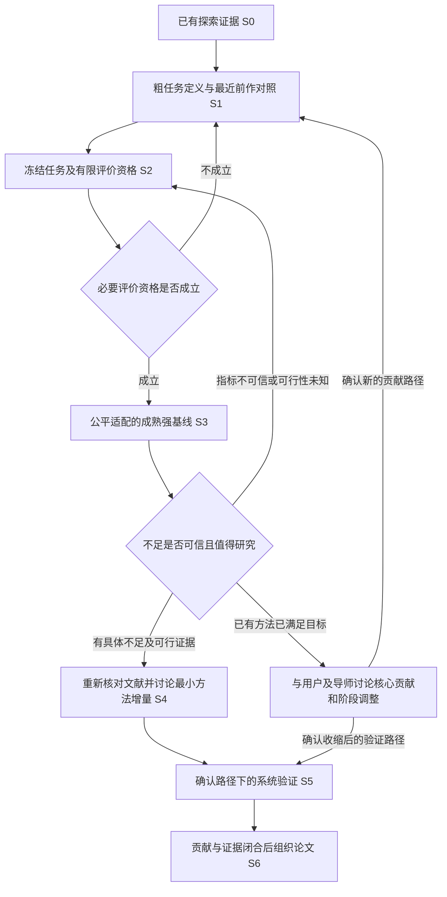

# 轮式双臂机器人受控制动持物研究：总体规划

版本：0.128，2026-11-11。**S3进行中，S4待开始。2026-11-10托盘批次截至俯仰回稳试验累计175次697861步（含方块探针22次95500步），后续箱内配重批次按S3分节记录。乐聚空卷盘和200 g居中／左右偏心卷盘均通过原装夹爪连续资格。卷盘0.4–0.6 m/s速度／制动强度七工况均通过本批资格，六例新增。五条左偏存档动作的首轮名义受力筛选均通过，两档速度均与原排序同选。逐手复核中等分模型接近存档合力，固定分担下左偏侧力矩余量更紧但五候选仍全部通过。左偏卷盘同底盘缓冲及同底盘同物体参考的腰臂分工对照均通过闭环。腰臂分工明显改变关节运动量。接触复核已分开卷盘中心微动、四个指垫的固定点相对位移及接触区迁移，局部轻载触边作诊断。主评价是制动期间和停稳后的双手抓持稳定。25 cm、1 kg方块的原装外壳侧抱和夹指平面贴侧均未通过静态，宽垫结果作为历史诊断。后续试验按稳定抓持、正常行进、触发制动和停稳持物的连续流程组织。5 cm保留为历史批次门槛，新实验报告实际净空并检查无障碍接触。恢复入口见[S3当前交接](plans/34-s3-mature-stop-baselines.md#当前交接与恢复入口)。**

本文件作为当前总体规划的唯一入口。原[选题与实验记录](../outputs/robot-topic-study/双课题范围更新.json)保留历史事实和成果索引；已有31份小节记录归入前期探索，不将它们当成31个论文工作包。今后具体小节计划从本文件链接，按需制定，不提前写完所有实现细节。

## 1. 本轮规划边界

### 1.1 已确认目标和协作要求

- 研究对象：抓取已经完成的单台轮式双臂机器人，在危险触发、底盘受控制动时的持物问题。水只是早期例子，不能把研究限定为液体；第二课题暂不推进。
- 研究阶段：研一、先仿真，目标是收敛出一个可形成独立论文的问题；发表、毕业达标和最终创新均未获保证。
- 当前工具：Python＋MuJoCo；MATLAB暂缓。真实硬件尚未选定，真机及可标定夹持实验资源待确认。
- 当前S3触发/腰臂事件结果的编译模型范围（2026-11-02核验）：轮端±20 N·m诊断分支，夹指同步neq=2，μ=0.8/NoSlip=0，0.4 m/s/0.5 kg/0.5 ms。不是已标定真机条件；全项目默认10 N·m模型与其他历史诊断结果分别保留。旧低障碍缓冲对照neq=0，不作当前同步模型资格。
- 用户本轮要求：先建立总体规划，再逐小节讨论与实施；文献调查进入明确节点；不能由每个新话题直接生成下一批实验。
- 用户最新协作授权（2026-11-02）：“你自己推进”。已确认主目标内的常规数值调查、小范围实现和预先限额验证自主推进；不为每个普通步骤重复提问，保持简短进度及证据记录。重大目标/架构/重要依赖、明显成本增加或实机动作另作实质讨论。
- 当前交付：S1调查、S2任务与观测合同，以及S3的障碍筛选与执行链路、成熟动作族与联合参考、接触诊断、四档右立柱参考筛查和三对横挡闭环。累计口径见首页，逐批证据见S3小节。真实驱动能力、一般状态下的执行资格与持物受力约束的贡献待验证。

本轮恢复从[S3当前交接](plans/34-s3-mature-stop-baselines.md#当前交接与恢复入口)开始。用户的原理或进度追问先解答，重复现象先复用已有结论。

2026-11-11。[阶段交接与证据索引](plans/34-s3-mature-stop-baselines.md#阶段交接与证据索引)汇总卷盘避障缓冲、托盘同权限抑制盘上滑移、弯道执行边界，以及箱内隐藏载荷下的腕部反馈与双臂纠偏。托盘已有同底盘和托盘平移的闭环证据，严格俯仰回稳仍有失败。箱体已有两条连续扰动和一条被动碰壁的制动期姿态收益，抓点与停后姿态仍待改进。S3继续进行，S4待开始。

### 1.2 用户明确的最终目标

在初速度相对较高、可用停止距离较短的危险触发情形下，根据当前障碍信息与机器人/载荷状态，选择底盘制动运动路线和速度随时间的变化，并协调躯干、双臂姿态及力矩/载荷分配，在避碰和可执行的条件下获得多指标意义上的末端与持物稳定停止。能够改善到什么程度，由后续证据决定，不预先承诺所有指标同时改善。

这是整体系统目标，不能继续把它缩减为“只降低加速度”，也不要求现在把所有组成模块都做成新的算法贡献。单篇研究的核心增量和范围在S1/S2内调查，若需要修改最终目标，应重新与用户讨论。

### 1.3 目标分解与当前约定

| 层次 | 要回答的问题 | 当前状态 |
|---|---|---|
| 障碍与可用停止空间 | 障碍挡住底盘、躯干、手臂还是载荷，哪些运动仍可选 | 原4场景及新3立柱筛选；转停10 N·m条件碰撞，20/40诊断条件无碰撞，条件与来源须明确 |
| 制动路线与速度 | 怎样在受限空间中选择停止运动路径及减速过程，最终停止 | 直停A连续区间、局部转角、联合候选及固定时长v/ω曲线样例已实现；尚无全局联合最优或实时资格 |
| 腰臂姿态与执行 | 怎样分配底盘/躯干/双臂运动，保持双手任务一致且可执行 | 共享物体IK及20关节曲线已接入，前伸/部分缓冲/侧移有限动作已执行；一般姿态/接触动力学资格仍未完成 |
| 动力学与力矩分配 | 关节驱动力矩、双手载荷分担及夹持内力怎样与运动配合 | 有逆动力学和若干分担基线；完整闭环力协调未建立 |
| 稳定评价 | 物体运动、相对位姿/接触运动、受力和停车后行为是否改善 | 已有多类记录；可信度、主指标及适用范围需逐项核查 |

底盘路径和速度在最终目标中是可选变量；“给定底盘曲线”的已有实验仍保留为受限权限基线，不再作为唯一主任务。制动路线指危险触发后朝停止状态的运动，不是借绕远路继续原作业。

研究仍以受控制动期间上身可控为前提。第一版规划层可先接收已知/当前估计的障碍几何，不自动扩展成雷达识别、建图或VLA课题。若纳入动态障碍，应区分当前估计/预测与未来真实状态，不能读取未来真值作决策。

“较高初速、较短距离”需要结合平台能力、停止接口和任务核查；当前0.4 m/s、0.5 kg等结果仅是已有名义工况，不写成高速能力验证，也不直接指定新的速度、摩擦或损伤阈值。

### 1.4 阶段授权与当前边界

用户已授权其余问题自主调查。S1按[具体计划](plans/32-s1-literature-and-integrated-stop-scope.md)核查前作覆盖、控制变量/接口、可复用基础、多指标评价和路线代价。本节不实施新控制器、物理仿真或硬件，不由调查自动批准后续算法。

S1结果见[联合制动路线与多指标稳定调查](../outputs/robot-topic-study/s1-integrated-stop/联合制动路线与多指标稳定_首轮调查.md)。9项重点工作均核验书目，6项定向读方法/实验、2项摘要、1项元数据；检索/访问限制逐项记录，不作为系统综述。用户已授权沿“任务/物体空间停止规划＋全身动力学执行”的分层组织方式推进，以成熟动作族和连续调参建立强基线；未冻结MPC/QP等具体算法，也未证明创新。

[S2](plans/33-s2-task-model-metric-qualification.md)已按有限名义范围收口。首轮6次发现转向跟踪与停止后补转；第二轮9次形成可选轮速PI、航向反馈和停止优先执行，见[S2结果](../outputs/rby1-research/s2-qualification/tracking/S2执行修复与停止优先验证.md)。默认关闭三次回归逐值一致；当时7 cm轮宽下转角约±9.5°，轮轴终点误差约5 mm。[S3](plans/34-s3-mature-stop-baselines.md)获准进行有限轮宽对照，5 cm场景使对应误差约降至1.4 mm。模型/硬件资格仍有限，不能将参考几何直接当实际安全保证，也未证明抓持优越性；后续强基线细节仍需按阶段入口细化。

## 2. 当前事实与证据边界

### 2.1 术语

- **受控制动**：底盘停止期间上身保持供电和控制能力。断电急停后的主动补偿不属于已验证范围。
- **停止策略**：物体/底盘停止参考及上身运动分配。历史实验预先指定策略；S3原型开始由触发状态和障碍筛选有限参考，完整联合与实时策略尚未实现。
- **闭环执行**：使用机器人/物体状态修正跟踪和姿态。具备闭环执行不等于具备环境决策。
- **制动负荷**：物体加速度、接触力/力矩等分量或明确归一化量；不能混成一个无物理解释的“稳定分”。
- **抓持表现**：相对位姿、接触运动、接触保持和停车后行为。参考原点的手系相对位移、接触切向速度路程和材料点真实滑移是不同观测。
- **几何资格**：检查指定轨迹是否在所查样本中与障碍相交。它不证明闭环动力学成功或连续安全。
- **控制权限**：底盘制动是否允许调整，以及上身可以如何运动。不同权限的结果必须分开比较。
- **停止终态**：目标是进入静止持物；没有任务依据时不强加任意精确终点位姿。当前执行候选在参考T后优先零速保持，实际终态与运动误差单独记录；如环境要求精确终态几何，应显式验证。
- **物体参考与抓持坐标**：当前外部payload参考位置是质心COM；既有抓持变换相对物体本体原点。使用共享物体位姿时须按已知COM偏置转换，不能混同COM、本体原点和TCP。
- **执行验收与模型诊断**：未通过某个冻结实验门槛仅说明该条件不满足，不自动证明硬件危险、任务不可行或方法无效。旧失败与版本保留；未来门槛改变须说明物理/数值依据并讨论，不事后改写结果。
- **数值求值与参考/物理准入**：离线差分可返回可计算但越界参考的f/g及不合格标志；映射无效或非有限仍明确失败。数值上可求值不等于参考合格或准入执行，原门槛和历史失败保持。

### 2.2 主张—证据表

下表的“已验证”仅限链接中的名义模型与检查范围，数值是仿真结果。

| ID | 主张 | 证据与入口 | 状态/限制 | 对规划的影响 |
|---|---|---|---|---|
| E01 | 已有可执行的轮式双臂研究模型和接触求解产生的载荷记录 | [模型阶段](plans/02-rby1-research-base.md)、[持物阶段](plans/03-dual-arm-payload.md) | RB-Y1名义模型；支撑、部分能力参数和接触未经真机标定 | 复用，不从头建平台；“有模型”不能替代物理有效性 |
| E02 | 同样较快底盘制动，上身缓冲降低物体加速度及单手TCP接触力矩约一半 | [第26节结果](../outputs/rby1-research/stage26/summary.json)、[核验](../outputs/rby1-research/stage26/delivery_check.json) | 0.5 kg、0.4 m/s等当前工况；物体多前移约6 cm、晚停约0.3 s | 有物理取舍值得调查，尚不说明抓持更稳或方法新颖 |
| E03 | 同一物体停止曲线，底盘单独柔和停止也可取得相近惯性负担 | [第26节计划及结果](plans/26-base-upper-stop-allocation.md) | 底盘需有更长停止空间/时间 | 必须保留强基线，并保持控制权限一致 |
| E04 | 当前接触处理显著影响停车后慢漂 | [第27节结果](../outputs/rby1-research/stage27/summary.json)、[核验](../outputs/rby1-research/stage27/delivery_check.json) | NoSlip3为诊断分支；不是真实接触标定 | 不用微米级排名或任意位移阈值制造控制收益 |
| E05 | 完整底盘位姿补偿改善手的世界跟踪，但未使抓持指标一致改善 | [第30节结果](../outputs/rby1-research/stage30/summary.json)、[核验](../outputs/rby1-research/stage30/delivery_check.json) | 4次候选＋1次回归；特定整形参数、名义模型 | 保留可选基线，不自动扩展成主研究方法 |
| E06 | 相同前表面，不同高度障碍可否定不同停止动作 | [第31节结果](../outputs/rby1-research/stage31/summary.json)、[核验](../outputs/rby1-research/stage31/delivery_check.json) | 4场景×4旧动作，6416状态—场景组合；几何重放，无新动力学 | 环境空间应明确到整机/载荷几何；还需验证在线决策与闭环执行 |
| E07 | 成熟停止参考连续调参已能覆盖部分名义几何限制 | [第25节算术核查](../outputs/robot-topic-study/gap-audit/研究缺口核查与最小验证草案.md)、[第31节候选](../outputs/rby1-research/stage31/continuous_reference_summary.csv) | 一部分只为参考/运动学资格；不能违反固定底盘停止接口 | 击败少数固定参数不能证明新算法必要 |
| E08 | 截至S0，停止动作仍为预先指定 | [运行入口](../simulation/rby1/run_stage30.py)、[停止参考](../simulation/rby1/stop_allocation.py)、[第31节范围](plans/31-obstacle-geometry-qualification.md) | 历史事实：3.5 s预设触发、预选动作；S3新增有限环境筛选见E13 | 原实现缺项不等于学术空白；新原型也不自动成为论文贡献 |
| E09 | 抓持稳定改善、跨物体通用和新方法必要性尚未确立 | E02–E08、既有文献调查 | 未知/待检验 | 不能预写成项目预期必然成果 |
| E10 | 新独立探针的名义直线执行较好，±10°转向约只实现±6.15°且仍慢转 | [S2首轮结果](../outputs/rby1-research/s2-qualification/S2首轮验证说明.md)、[原始指标](../outputs/rby1-research/s2-qualification/metrics.json) | 6次有限运行；新固定姿态执行探针，非原缓冲控制器；半步长仍有误差 | 先处理二维执行基础，不能把下层误差归为上层规划缺口 |
| E11 | PI＋航向反馈改善名义转向，停止优先显著减少T后补转；指标有代价 | [S2第二轮结果](../outputs/rby1-research/s2-qualification/tracking/S2执行修复与停止优先验证.md)、[核验](../outputs/rby1-research/s2-qualification/tracking/delivery_check.json) | 9次；左右最终约±9.5°，T后净转约0.011/0.014°；指令切换及运动加速度代价、轮地/接触假设仍在 | 可复用有限执行基线；S3必须检查实际几何和多指标，不把更准跟踪当整体更稳 |
| E12 | 仅将碰撞轮宽7 cm改为与网格外形一致的5 cm，改善当前转向跟踪及部分受力指标 | [轮宽对照结果](../outputs/rby1-research/s3-wheel-width/轮宽对照结果.md)、[核验](../outputs/rby1-research/s3-wheel-width/delivery_check.json) | 新增4次、9500步；左右终点XY误差约5→1.4 mm；直停基本不变，左转半步长趋势保持；角速度等非全改善，慢漂未解决 | 后续新实验优先采用5 cm名义场景，保留旧证据；不是实机标定、整体稳定优越性或新算法贡献 |
| E13 | 障碍已进入有限候选筛选，入选动作在3个启用碰撞的场景中完成物理执行 | [链路结果](../outputs/rby1-research/s3-scene-chain/障碍筛选与实际停止_结果说明.md)、[核验](../outputs/rby1-research/s3-scene-chain/delivery_check.json) | 4场景×6参考，新增3次5474步；实际最小间隙120.26/2.93/5.15 mm，高墙集合内无解；物体负荷随更短停止增加，慢漂仍在；每场景候选计算约0.85–1.05 s，规划时暂停仿真时钟 | 单候选链路通过，环境选择已开始；不等于实时控制、完整避障路线选择、连续强基线或新腰臂协调 |
| E14 | 固定姿态直停可从几何首碰位置求连续A区间，并执行数值边界探针 | [连续直停结果](../outputs/rby1-research/s3-continuous-straight/连续直停参数与边界执行_结果说明.md)、[核验](../outputs/rby1-research/s3-continuous-straight/delivery_check.json) | 新增3次7237步；低障碍/横挡A约0.5856/0.5740，实际间隙约0.224/0.162 mm；横挡半步长降至0.071 mm；均无记录到的碰撞，慢漂未改善。限定直停分支首次几何计算中位数25–31 ms | 连续直停对照成立；数值贴边不是安全策略，尚无实时接管、连续转向或全身方法资格 |
| E15 | 只按参考几何选择较强转停，不能保证当前执行器通过 | [转向失败记录](../outputs/rby1-research/s3-turn-selection/转向筛选与执行失败_结果说明.md)、[核验](../outputs/rby1-research/s3-turn-selection/delivery_check.json) | 冻结3立柱、59次预测；左右选A=1.0、约±8.05°，参考间隙约3.8 mm且0.5 ms加密仍通过。2次3200步实际均碰撞；约0.09 s轮指令先超设定范围，约0.35 s接触载荷；碰撞前多走约8 mm、航向落后约1.7° | 该设定下的失败保留；后续归因见E16，不再据此优先推动能力约束研究，也不证明真机不可行 |
| E16 | 原转停失败对自行设置的10 N·m上限敏感，不能直接立为研究难点 | [来源与敏感性](../outputs/rby1-research/s3-wheel-limit-sensitivity/轮力矩上限来源与敏感性_结果说明.md)、[核验](../outputs/rby1-research/s3-wheel-limit-sensitivity/delivery_check.json) | 新增右20/左20/右40共3次4800步，只改两轮3层限幅；均未碰撞，实际间隙约1.87/1.23/1.87 mm，右20/40全部轨迹/控制数组逐值相同；官方所查资料未给可靠轮轴力矩上限 | E15不再作为优先开展能力约束研究的依据；参数仍待标定，回到同条件腰臂协同比较，20/40仅诊断分支 |
| E17 | 同一低障碍下，成熟腰臂缓冲降低制动负荷，但不解决停车慢漂，且需要额外上方空间 | [公平对照](../outputs/rby1-research/s3-upper-buffer/腰臂缓冲公平对照_结果说明.md)、[核验](../outputs/rby1-research/s3-upper-buffer/delivery_check.json) | 新增3次5700步；快停/柔和底盘/缓冲加速度峰值1.003/0.589/0.502 m/s²，TCP力矩0.04143/0.02439/0.02083 N·m；共同停车窗慢漂均约0.156 mm。缓冲比柔和底盘物体多前进约20 mm，原横挡/左右立柱参考拒绝；均用20诊断条件且轮请求低于7 | 需要一起选择路线、减速与缓冲量，不能固定前伸；负荷改善不等于整体持物稳定或新方法贡献 |
| E18 | 联合候选中缩小缓冲，可使旧横挡和右立柱执行部分缓冲；收益与间隙需同时比较 | [联合候选](../outputs/rby1-research/s3-joint-candidates/联合候选与部分缓冲_结果说明.md)、[核验](../outputs/rby1-research/s3-joint-candidates/delivery_check.json) | 423次参考评估，新增4次配对＋1半步长共11400步；横挡13.1 mm、右立柱4.47 mm缓冲均无障碍接触，实际间隙29.35/3.29 mm；右转半步长3.10 mm。减轻部分负荷但抓持观测不一致改善；居中集合内无解，五场景离线准备约48 s | 环境相关选择链路已有有限证据；须保留强底盘解释、预测—实际差异及评价边界，下一步按S3核对同权限前作适配，不直接宣称创新或进入S4 |
| E19 | 通用参考保持旧执行；原三参数族内连续优化可得到零缓冲动作，但改善有限且有取舍 | [有限优化结果](../outputs/rby1-research/s3-optimization-pilot/有限停止优化与通用参考_结果说明.md)、[核验](../outputs/rby1-research/s3-optimization-pilot/delivery_check.json) | 新增4次9500步，含两次逐值回归；右转A≈0.917、−10°、零缓冲，1/0.5 ms两档RMS加速度约降0.39/0.29%，峰值约升5.51/4.02%；TCP力矩略降，慢漂不变，实际间隙3.255/2.961 mm。低障碍仍原动作并复用历史执行 | 允许零缓冲、保留多指标取舍；局部三参数优化不是完整全身OCP/MPC或前作复现，下一入口评审轨迹表示，而非继续靠调参论证创新 |
| E20 | 现有运动学可支撑更一般轨迹表示的有限样例，但可达性不等于避障 | [轨迹表示评审](../outputs/rby1-research/s3-trajectory-representation-review/整段停止轨迹优化_方案与成本评审.md)、[实测](../outputs/rby1-research/s3-trajectory-representation-review/preflight.json) | 两个所查姿态固定双手后有8维局部零空间；18个静态IK均收敛，2个障碍相交。41节点回调中位数13.50 ms，非完整求解耗时；Jacobian/Jdot差分通过。评审阶段0次优化、0物理步 | 直接参数化腰臂与差速速度曲线的有限样例随后获授权并形成E21；不将前期静态IK、回调或文献方法当成轨迹执行通过 |
| E21 | 整段曲线可选出侧移动作，负荷和间隙改善，但抓持观测仍有取舍 | [整段轨迹结果](../outputs/rby1-research/s3-whole-trajectory/整段停止轨迹与实际抓持_结果说明.md)、[核验](../outputs/rby1-research/s3-whole-trajectory/delivery_check.json) | 两项SLSQP均40迭代未收敛；RMS目标的早期合格点侧移约25.7 mm，力矩目标仅初始差分探针。4次11400步；两步长实际加速度RMS约降11.6%、力矩RMS约降12%，实际间隙约5.35/5.34 mm；停车总相对位移约增32%，主要新增法向X约0.13 mm，Z慢漂基本不变 | 有限动作权限收益，不是最优/实时/整体抓持改善或创新；先定位法向相对运动及优化未收敛原因，保留失败与接触数值边界 |
| E22 | 新增法向漂移主要是夹指中心运动；研究模型遗漏官方同步关系 | [诊断说明](../outputs/rby1-research/s3-whole-trajectory/diagnosis/夹指同步遗漏与优化未收敛_诊断说明.md)、[来源审计](../outputs/rby1-research/s3-whole-trajectory/diagnosis/finger_source_audit.json)、[核验](../outputs/rby1-research/s3-whole-trajectory/diagnosis/delivery_check.json) | 旧模型neq=0，冻结官方源有两条q₁+q₂=0等式；新增位移中物体相对指垫中心法向变化≤约1.33e−5 mm，整体漂移约0.13 mm。速度型夹指受力平衡预测吻合；新副本neq=2、其他模型参数不变，但只静态载入。250次只读回调定位优化末段违反相容性，无新求解/物理步 | 先恢复同步并重查配对，旧模型抓持结论不自动沿用；优化问题独立保留，不能把未收敛称为任务无解，也不靠放宽约束掩盖失败 |
| E23 | 恢复官方夹指同步显著抑制新增法向漂移，但总抓持位移仍未改善 | [同步恢复结果](../outputs/rby1-research/s3-finger-sync-repair/夹指同步恢复与固定动作复核_结果说明.md)、[核验](../outputs/rby1-research/s3-finger-sync-repair/delivery_check.json) | 默认33数组逐值回归；5次13300步；法向净位移约0.13→0.001 mm，竖直约0.156 mm/秒仍在。修正模型两档加速度RMS约降11.6%、力矩RMS约降11.7%/12.0%，总相对位移约增0.85%/0.83%；软约束有残差 | 修复只在显式同步场景下验收，不默认替换全部历史模型；保留有限负荷收益及慢漂边界，随后评审优化可行性恢复，不能宣称整体抓持/创新/实时资格 |
| E24 | 有限数值探针说明局部缩步有用但不足，并构造出加密合格的预测力矩参考 | [求解路线评审](../outputs/rby1-research/s3-solver-review/双手相容约束与求解路线_评审.md)、[独立核验](../outputs/rby1-research/s3-solver-review/delivery_check.json) | 主回调231次＋独立5次，另旧模型4点比较；0新非线性求解/物理步。RMS初步5%方向采样可行，合格点到轻微越界末点的中间连线仍严重越界；固定半步力矩方向按实际峰值赋eta后1245时刻通过，未实际执行 | 不把失败称无解，不把采样/预测收益称抓持收益；推荐同权限成熟后端离线对照，随后已获授权并完成E25 |
| E25 | 两后端同权限离线对照均未收敛，未获得有意义的合格新参考 | [对照结果](../outputs/rby1-research/s3-solver-compare/同权限两后端离线对照_结果说明.md)、[独立验收](../outputs/rby1-research/s3-solver-compare/delivery_check.json) | SLSQP/trust各40主迭代，2835/2761完整评价，91.96/92.12 s。SLSQP最佳采样点在加密相容性检查中拒绝；trust合格点仅初值1e-6差分，末点主要违反jerk；零新物理，源/数据守护通过 | 保留原已验证参考；有限失败不证明任务无解、排除全部成熟方法或建立创新。下一候选为约束表示/尺度与全局化过程评审 |
| E26 | 当前五次速度表示的4个纵向系数被原限制隐式固定；准确积分及仿射表示可独立核查 | [本轮结果](../outputs/rby1-research/s3-structured-conditioning/速度表示固定自由度修正与执行_结果说明.md)、[固定面证书](../outputs/rby1-research/s3-structured-conditioning/base_face_certificate.json) | 8个上下界及8个对偶复核，最大残差约1.31e-15；45点梯形RMS偏差约0.05%，Gauss12/24吻合；2次结构化NLP仍40迭代未收敛 | 修订旧“自由纵向优化”能力边界，不能把表示限制当任务无解；保留失败，使用实际可动的速度表示 |
| E27 | 新C1速度参考恢复非零纵向选择，并完成整机及实际执行复核 | [参考核查](../outputs/rby1-research/s3-structured-conditioning/velocity_reference_check.json)、[实际结果](../outputs/rby1-research/s3-structured-conditioning/execution_summary.json)、[独立验收](../outputs/rby1-research/s3-structured-conditioning/execution_delivery_check.json) | 零修正回归误差0；两条固定构造参考、两档步长4次11400步，实际RMS约降0.28%–0.38%。A间隙增至6.84/7.02 mm但力矩峰值不全改善；B力矩峰值降1.34%/4.17%但间隙减至4.37/4.24 mm；停车慢漂基本不变 | 新表示与执行能力有证据，不是NLP收敛/整体抓持改善/论文创新；后续相同目标内有限推进由助手安排 |
| E28 | 当前同步模型的静止慢漂对求解设置高度敏感，低摩擦下仍会下落 | [接触基线复核](../outputs/rby1-research/s3-contact-baseline/当前模型接触慢漂基线复核_结果说明.md)、[独立验收](../outputs/rby1-research/s3-contact-baseline/delivery_check.json) | 新增9次22650步；同姿态/零速冷启动、6次标称静止与3次低摩擦诊断；原/半步长相对运动幅值约0.156/0.0158/0.000807 mm/s。低摩擦承载上界约2.067 N<4.905 N、早期下落；后段手指超速，负对照不算动作合格 | 默认保留，impratio100优先作有限动态复核候选、NoSlip作更强抑制对照；不是控制收益、零滑移、真机标定或动态刹停通过 |
| E29 | 较硬接触减小原动作停车相对运动，但负荷峰值上升且动态批次停止 | [停止与诊断](../outputs/rby1-research/s3-contact-dynamic/较硬接触动态配对_停止与诊断说明.md)、[独立诊断](../outputs/rby1-research/s3-contact-dynamic/failure_diagnosis.json)、[未通过验收](../outputs/rby1-research/s3-contact-dynamic/delivery_check.json) | 实际1次1900步，剩余3次未运行；同曲线/初态/控制仅impratio10→100，停车相对位移0.1583→0.0185 mm，加速度峰+5.01%、TCP力矩峰+19.10%；2个0.0675–2.177 µm轮地间隙采样，旧设置也有，旧半步长无此现象 | 原设置也存在轮地/峰值资格边界，不能将其归为新设置独有故障；默认不替换，优先明确接触切换和峰值步长敏感性，未证明整体持物或动态资格改善 |
| E30 | 同动作两设置×两步长表明聚合轮地缺失和峰值对时间网格敏感，慢漂取舍仍在 | [步长复核结果](../outputs/rby1-research/s3-contact-timestep/接触与步长配对复核_结果说明.md)、[独立核验](../outputs/rby1-research/s3-contact-timestep/delivery_check.json)、[共同观测网格](../outputs/rby1-research/s3-contact-timestep/sampling_grid_check.json) | 新增1次3800步、复用3次；半步长下两设置均无聚合零轮接触采样，较硬力矩峰约+3.59%、相对运动−88.30%、间隙少0.253 mm；单轮微小离地仍在。控制更新周期随物理步长改变，加速度细小峰值排名随观测网格反转 | 后续有限对照优先0.5 ms，原默认接触保留、100仍为敏感性分支；不能称渐近收敛、双轮持续承载、整体抓持或规划器收益 |
| E31 | 成熟SLSQP可自动选择新纵向系数，连续标量约束补全后参考合格；实际候选仍有取舍且被拒绝 | [本轮结果](../outputs/rby1-research/s3-velocity-planning/自动纵向速度规划与节点间约束_结果说明.md)、[补全后求解](../outputs/rby1-research/s3-velocity-planning/continuous-limits/solve/plan.json)、[实际拒绝](../outputs/rby1-research/s3-velocity-planning/continuous-limits/execution/selected/admission.json) | 首轮4迭代节点间−1.000566 m/s²越限；补全精确原v/a/jerk后8迭代，64系数保持、原加密通过。新增1次3800步，相对load实际RMS−0.29%、间隙+0.617 mm，但力矩峰+17.48%、聚合轮地零接触2次，未纳入可用集合 | 四变量受限成熟基线成立，非全68变量/全局最优或整体抓持改善；保留失败和旧参考，不调参解救、不把微米级接触当创新，返回同权限强基线与相容性表示评审 |
| E32 | 联合强基线评审区分局部抓持冗余、参考表示及实验门槛，形成下一候选 | [只读评审](../outputs/rby1-research/s3-joint-baseline-review/联合强基线与双手相容性表示_评审.md)、[运动学核查](../outputs/rby1-research/s3-joint-baseline-review/representation_probe.json)、[审计入口](../outputs/rby1-research/s3-joint-baseline-review/delivery_check.json) | 三构型、44回调、零新优化/IK/物理；共享物体相对任务秩6/局部零空间14，固定世界双任务秩12/零空间8；中间Jacobian差分误差约4.81e-10。局部结果不证明全局参数化或旧失败因果；附加零轮接触门槛未获硬件标定 | 推荐先验证共享物体参考＋共享IK的接口/分支/导数一致性，现有一维IK不能当任意SE(3)；新表示仅候选，原关节路线保留，正式选择待讨论，旧失败不改 |
| E33 | 共享物体参考可在旧RMS回放中映射成相容q/v/a，有限样例通过 | [样例结果](../outputs/rby1-research/s3-shared-object-prototype/共享物体参考映射小样例_结果说明.md)、[独立核验](../outputs/rby1-research/s3-shared-object-prototype/delivery_check.json) | 76 IK（73目标/3重复）、185 QP/370内部步、约1.73 s，零新整段优化或物理；h减半导数差约降到1/4，25参考几何节点通过。初始上身速度仍与保存物理状态差约5.49e-5 rad/s；未审计中间查询拒绝 | 新表示有局部有限回放证据，非通用SE(3)/外层联合优化/实际接管资格；原接口与旧参考保留，下一步明确连续查询、初值合同和联合变量，再定预算，不自动替换或进入S4 |
| E34 | 连续共享物体参考的初态接续、变量及公平边界已评审 | [方案评审](../outputs/rby1-research/s3-joint-reference-contract/连续参考初值与联合变量_方案评审.md)、[初态/基函数审计](../outputs/rby1-research/s3-joint-reference-contract/initial_state_and_basis_audit.json)、[预算建议](../outputs/rby1-research/s3-joint-reference-contract/proposal.json) | 零新IK/优化/物理；触发物体竖直速度−0.15614 mm/s、旧参考为0；双手速度差原归一最大0.006226，初始上身速度差约5.49e-5 rad/s。五次8控制点边界矩阵秩5，50参数仅局部候选，非旧68族等价证明 | 推荐先沿用旧名义参考边界作4条/404 IK/120 s隔离连续适配与成本资格；实际初态不变，不声明无缝接管、不准入新物理；正式联合采用/外层优化及实际接续方案待决策 |
| E35 | 连续共享物体接口支持旧参考新增时刻与查询顺序一致性；原四条批次整体失败保留 | [有限结果](../outputs/rby1-research/s3-continuous-reference-qualification/连续参考适配_有限验证结果.md)、[主结果](../outputs/rby1-research/s3-continuous-reference-qualification/result.json)、[独立审计](../outputs/rby1-research/s3-continuous-reference-qualification/delivery_check.json) | 两条各101节点回放通过、q/v/a逐值一致；202 IK/398 QP/796内部步/4.866 s，零外层优化和物理。第三条预声明扰动jerk 5.0023988超过5，IK前停止，第四条未运行，完整批次passed=false | 接口代码已实现，但非零组合IK、完整50维/全时域/实际接续与外层评价成本未验证；新两条可行单侧输入仅草案，不改原限制或追认旧失败，不自动启动新批次或S4 |
| E36 | 两条可行单侧方向的非零连续参考映射及导数/几何通过；目标具有可复用代数结构 | [有限结果](../outputs/rby1-research/s3-feasible-reference-directions/两条可行方向_核验结果.md)、[独立核验](../outputs/rby1-research/s3-feasible-reference-directions/delivery_check.json)、[目标审计](../outputs/rby1-research/s3-feasible-reference-directions/objective_structure.json) | 每条101节点，202 IK/398 QP/796内部步/3.950 s，零新外层优化/物理；物体变化约1.084 µm。完整运动标量、所查几何和两档差分通过，非全50维或物理资格；固定T的COM平方加速度目标只直接依赖9平移系数，其余41约束仍重要 | 本批收口；下一候选为一个零参数完整f/g样例，45节点/60求积、最多45 IK/200 QP/400内部步/30 s，尚未启动；先测成本再定外层求解和导数，原68路线/旧失败/接触门槛保留，S4不自动开始 |
| E37 | 一次共享物体完整采样f/g评价与原约束/目标吻合，并定位初始化成本 | [成本结果](../outputs/rby1-research/s3-complete-reference-evaluation/完整目标约束评价_结果与成本.md)、[原实现重算](../outputs/rby1-research/s3-complete-reference-evaluation/delivery_check.json) | 一个零候选，45 IK/87 QP/174内部步，4860原约束逐值差0，60求积共享目标与旧种子差约3.89e-16；运行1.377 s含1.046 s初始化。映射一致性限45约束节点，非60点IK/全时域/物理或完整优化资格 | 优先复用固定准备并核验私有数据/候选缓存等价性；下轮拟零及已合格非零两个完整评价，90 IK/400 QP/800内部步/30 s，未启动；不直接搬用旧50变量数值差分/求解预算，S4待开始 |
| E38 | 固定准备复用保持两条完整f/g数值及候选数据隔离，得到后续评价成本样本 | [复用结果](../outputs/rby1-research/s3-cached-reference-evaluation/固定准备复用_等价性与成本结果.md)、[独立重算](../outputs/rby1-research/s3-cached-reference-evaluation/delivery_check.json)、[求解准备评审](../outputs/rby1-research/s3-cached-reference-evaluation/solver_readiness_review.json) | 90 IK/174 QP/348内部步；准备2.843 s，后续0.318/0.331 s、整批3.719 s；各4860行与原实现差0，零参考相对冷记录差约2.38e-14。无Jacobian/优化/物理；仅两条既有参考和45约束点 | 优先明确离线数值域/原资格分离、4条固定活动端点行；下一拟52评价/2340 IK/90 s数值Jacobian诊断，仅草案未实施，不放宽物理门槛或自动选择正式求解器；S4待开始 |
| E39 | 50参数数值域/Jacobian诊断完成，jerk折角得到等价双边同数据解释 | [诊断结果](../outputs/rby1-research/s3-reference-jacobian-diagnostic/数值导数诊断_结果与联合求解建议.md)、[独立审计](../outputs/rby1-research/s3-reference-jacobian-diagnostic/delivery_check.json)、[双边复核](../outputs/rby1-research/s3-reference-jacobian-diagnostic/signed_jerk_review.json) | 52评价/2340 IK/4524 QP/9048内部步/12.778 s；52条原向量重算差0，48条原参考检查合格、4条jerk越界，物理0。原jerk混合导数余项7.30，等价双边同数据4.66e-10；非全域精度/收敛证书，连续包络仍分段光滑 | 首次完整50参数SLSQP推荐方案待讨论：原4860验收保留、求解视图4928行、单次40迭代/600评价/180 s、至多一次最终加密参考检查；尚未实施或授权该新阶段，物理/真实接续/S4不自动开始 |
| E40 | 首次完整50参数SLSQP有限尝试已实施并预算停止，未得到新参考资格 | [限额结果](../outputs/rby1-research/s3-first-joint-solve/首次50参数联合求解_限额结果.md)、[独立证据](../outputs/rby1-research/s3-first-joint-solve/delivery_check.json)、[原结果](../outputs/rby1-research/s3-first-joint-solve/result.json) | 1调用/11接受迭代/594开始593完成评价，26719 IK/68082 QP/136164内部步，160.136 s在求解160 s截止处停；593原向量、全部接受点FK和11＋部分Jacobian复核。无正常收敛/加密/选择/物理。最后接受点RMS−0.06484%，间隙7.495→6.258 mm仅粗节点，预测力矩有取舍 | 本批收口但强基线目标未达成；原固定点诊断未实施并继续暂缓。E46给出固定目标收益上限，不追加同题预算或追认旧点；保留旧合格参考，S4待开始 |

| E41 | 连续行进时触发、计入选择延迟并接续直停，名义主例/超时回退均通过 | [结果](../outputs/rby1-research/s3-trigger-stop-demo/触发停车链路_名义仿真结果.md)、[合同](../outputs/rby1-research/s3-trigger-stop-demo/contract.json)、[独立核验](../outputs/rby1-research/s3-trigger-stop-demo/delivery_check.json) | 新增2次8000步，0.4 m/s/0.5 kg/0.5 ms，触发到减速度指令1.5/50.5 ms；距离13.400/15.359 cm，最小前沿间隙6.601/4.642 cm；控制与接触不调，q/v/指令接续审计通过。物体仍慢移0.156 mm/s | 补齐名义事件链；仅两条直停/固定上身、实测延迟注入及模拟计时器，非独立watchdog/硬实时/全身在线规划；后续有限腰臂接续见E42/E43；一般状态与真实实时资格仍未完成，S4待开始 |

| E42 | 旧合格腰臂动作可按巡航命令连续重定位，直接加密几何重查超时；直墙前沿缓存有限等价性通过 | [只读结果](../outputs/rby1-research/s3-upper-trigger-audit/腰臂触发接续_只读核查与成本.md)、[加密成本](../outputs/rby1-research/s3-upper-trigger-audit/dense_result.json)、[独立审计](../outputs/rby1-research/s3-upper-trigger-audit/delivery_check.json) | 3保存状态，C2分量最大约2.27e-16；1245点参考间隙2.811 cm、无非夹持自碰；冷准备1.35 s，加密重查402 ms。包络重现同网格距离至2.5e-16 m，标量比较微秒级；零新物理/IK/优化 | 该只读批次当时未验证接管动力学；后续单例已见E43。有限状态/直墙包络不扩大为一般适用域、任意障碍或硬实时 |

| E43 | 预加载旧腰臂参考在连续行进事件后实际接管通过，但当前工况指标未优于直停 | [结果与取舍](../outputs/rby1-research/s3-upper-trigger-execution/单次腰臂触发接管_结果与取舍.md)、[独立核验](../outputs/rby1-research/s3-upper-trigger-execution/delivery_check.json)、[同窗比较](../outputs/rby1-research/s3-upper-trigger-execution/common_window_comparison.json) | 新增1次4000步；0.2 s精确名义实态准入、0.25 s接管，准备3.375 ms，实际距离14.457 cm/间隙2.812 cm，原执行门槛通过；与旧直停501样本前缀一致，同窗加速度RMS+0.746%、较大单手矩RMS+12.915%、间隙减少 | 接管链路成立，稳定优越性未成立；两者底盘曲线/转向/上身同时变，非单因素因果；保留直停默认，仍无通用状态/硬实时资格 |

| E44 | 固定同一底盘参考可分离上身缓冲贡献，旧低障碍实际对照提供受限空间线索 | [只读评审](../outputs/rby1-research/s3-coordination-fairness-review/同底盘协调收益与适用工况_只读评审.md)、[结果](../outputs/rby1-research/s3-coordination-fairness-review/result.json)、[独立核验](../outputs/rby1-research/s3-coordination-fairness-review/delivery_check.json) | 仅60上身系数置0，底盘8系数与1245节点运动相同；协调参考加速度RMS−13.32%、预测手矩RMS−13.08%、间隙+2.97 mm。旧低障碍同底盘实际RMS约−24%，物体多行6 cm，但neq=0过时；当前neq=2/±20Nm诊断。2850运动学样本、零物理/IK/优化 | 当前宽墙仍直停优先；所建议的1次同底盘保持实际对照已在E45执行；不把有限参考或旧数据推广为当前真实稳抓/必要性/硬实时 |

| E45 | 同底盘实际对照观测协调减载约11%，保持组未过原轮接触门槛 | [结果](../outputs/rby1-research/s3-matched-base-execution/同底盘实际对照_减载观测与轮接触失败.md)、[配对指标](../outputs/rby1-research/s3-matched-base-execution/paired_comparison.json)、[独立证据](../outputs/rby1-research/s3-matched-base-execution/delivery_check.json)、[轮接触失败](../outputs/rby1-research/s3-matched-base-execution/wheel_contact_failure.json) | 新增1次4000步；全部8底盘参数与参考/501前缀相同，仅60上身系数置0。协调实际加速度RMS−11.057%、手矩RMS−11.696%；保持组4个孤立0.5ms零轮接触样本，最大距地约1.59µm，其余门槛通过，完整passed=false | 保留失败不重跑；该模型内减载观测不等于两组合格策略或材料滑移优势；已按既有敏感性结论限定为模型/判据边界，不重开无新证据的接触批次；不能改门槛追认或推断硬件危险，回到E46公平任务合同 |

| E46 | 旧固定T目标收益上限与当前有限候选取舍已核算，明确S3主线缺口 | [可追溯结果](../outputs/rby1-research/s3-mainline-consolidation/result.json)、[S3当前概览与任务草案](plans/34-s3-mature-stop-baselines.md) | 零新增物理/IK/QP/优化；固定离散目标相对种子RMS最多−0.066814%，最后点最多再−0.001976%。两条合格实际记录中，直停在负荷RMS及间隙三项支配协调，加入轮轴前进则成取舍；仅有限记录、非全局最优 | 同题续算、轮接触返修不再自动决定优先级；后续审计发现历史候选为neq=0，不能代替当前同步模型的B0覆盖；先核验当前轨道并冻结最小公平配对，S4待开始 |
| E47 | 当前同步模型下固定底盘直停的单因素配对支持缓冲减载，但未见停车后相对位置漂移改善 | [简短结果说明](../outputs/rby1-research/s3-continuous-b0-matched-buffer-v1/paired_result.md)、[配对数据及独立复算](../outputs/rby1-research/s3-continuous-b0-matched-buffer-v1/delivery_check.json)、[合同与原始运行](../outputs/rby1-research/s3-continuous-b0-matched-buffer-v1/) | 新增保持组1次/4000步；与已完成`buffer_mid`在A=0.75 m/s²、直行、当前`neq=2`宽墙同初态配对。共同制动窗物体加速度RMS低8.21%、较大单手TCP力矩RMS低8.14%；共同停车后1 s相对位置漂移约0.15610 mm，差−0.000014 mm。每组单次、仅名义工况 | 只支持该模型/控制器/场景下缓冲制动减载观测；不代表统计或真机泛化、材料点滑移改善、整体抓持稳定或方法优越性；保持组原轮接触失败另行保留 |

| E48 | 当前同步模型下两种原障碍布局已形成有限参考筛选和环境相关取舍 | [合同/逐候选数据/汇总](../outputs/rby1-research/s3-b0-environment-screen-v1/)、[独立P2](../outputs/rby1-research/s3-b0-environment-screen-v1/p2_gate.json)、[S3结果](plans/34-s3-mature-stop-baselines.md) | 276次评价含4先行点；活动耗时记录85.215 s（排除最终输出及质检等待）；P1/P2通过。low保持11/34、允许缓冲49/138，upper_bar17/34、40/138；同底盘可行组合为11→11、17→17，缓冲救回数均0。全为采样参考资格，零新物理/IK/QP | 当前证据支持减载、前伸、晚停与净空取舍，不支持底盘可行范围扩张、实际稳抓改善、全连续安全或MPC/RL必要性；不自动送0.205 mm贴边参考入物理 |
| E49 | 当前同步模型下两场景四例实际配对通过本批避碰、名义停止、接触及执行门槛，体现空间/时间/负荷取舍 | [合同/日志/逐例验收](../outputs/rby1-research/s3-b0-environment-physical-v1/)、[同窗配对汇总](../outputs/rby1-research/s3-b0-environment-physical-v1/summary.json)、[独立P2](../outputs/rby1-research/s3-b0-environment-physical-v1/p2_gate.json) | 新增4次16000步，P1/P2通过；实际采样间隙low保持/缓冲23.496/23.494 mm、横挡25.714/9.392 mm；缓冲物体多前进43.319/16.322 mm、名义停止晚216.5/80.5 ms。全运动窗加速度RMS−16.06%/−7.29%，共同保持漂移仍约0.156 mm。每例仅一次、固定同A=0.75 | 当前名义场景的有限实际执行资格已补齐，不等于稳抓改善、材料滑移证据、全部底盘策略优越、连续安全或MPC/RL必要性；预算用完，不追加运行，回到S3完成条件 |
| E50 | 原右立柱同步场景在同一参考时长内有合格B0；固定侧移相对这批B0保留预测负荷优势 | [冻结合同](../outputs/rby1-research/s3-right-column-b0-v1/contract.json)、[36点表](../outputs/rby1-research/s3-right-column-b0-v1/candidate_metrics.csv)、[S3口径](plans/34-s3-mature-stop-baselines.md) | 7/36几何和时长通过，3条零缓冲、4条小幅缓冲，全部−10°；最低预测RMS为零缓冲0.7850 m/s²，侧移同窗0.6748 m/s²；参考间隙6.259/7.495 mm。零新物理、IK、QP或外层优化 | 有限格点及不同密度的参考采样；旧基线执行有一帧聚合零轮接触，动态结论与本轮几何可行性分开 |
| E51 | 同一半步长执行口径下，右立柱侧移通过，B0最低预测RMS点在一帧聚合轮接触项失败 | [保存轨迹复核](../outputs/rby1-research/s3-right-column-b0-v1/execution_audit.json)、[验收与方案](plans/34-s3-mature-stop-baselines.md) | B0/侧移名义停止0.761/0.756 s，实际采样净空2.961/5.341 mm，物体加速度RMS 0.63718/0.56324 m/s²，手部接触矩RMS 0.029796/0.026211 N·m。B0零轮接触在0.231 s，左右轮几何间隙均小于1 µm。零新物理 | B0存在一个执行失败点。是否另有可执行的B0候选仍待核查，旧1 ms两组均有聚合零轮接触 |
| E52 | 右立柱最大参考净空B0补跑，实际净空较大，完整资格仍在轮接触项失败 | [合同](../outputs/rby1-research/s3-right-column-b0-physical-v2/contract.json)、[验收](../outputs/rby1-research/s3-right-column-b0-physical-v2/admission.json)、[S3结果](plans/34-s3-mature-stop-baselines.md) | 新增1次3800步，名义停稳0.7555 s，实际采样净空6.102 mm；两帧聚合零轮接触；侧移同窗物体加速度和手部接触矩RMS低14.02%和14.73% | 右立柱已有两个B0候选在当前共同轮接触判据失败，侧移半步长记录通过。其余候选未有当前同条件执行证据，实际负荷差是候选间对照 |
| E53 | 右立柱的聚合零轮接触伴随孤立总支撑力下降，事件时刻对步长敏感 | [5条存档复核](../outputs/rby1-research/s3-right-column-b0-physical-v2/wheel_contact_audit.json) | 9个孤立零接触样本，事件总竖直支撑216–288 N，紧邻样本1243–1538 N。1 ms两条各3帧，0.5 ms对应1/0帧，逐时刻无复现。轮轴、偏航、载荷跟踪误差均在各自事件前后5 ms的局部范围内 | 当前资料支持保留接触异常和负荷/净空取舍。未建立持续失稳或方法必要性。零新仿真 |

### 2.3 已有文献基础与阅读边界

已有[主线文献调查](../outputs/robot-topic-study/mainline-literature/主线文献调查_停止规划与腰臂协同.md)和[缺口核查](../outputs/robot-topic-study/gap-audit/研究缺口核查与最小验证草案.md)。它们是定向阅读记录，不是已完成的系统综述。本轮复核以下原文入口，不声称完成最新文献的全面检索。

| ID | 已有直接前作 | 本轮可用的事实 | 需要继续核对的边界 |
|---|---|---|---|
| L01 | [Berscheid/Kroeger，Ruckig，RSS 2021](https://www.roboticsproceedings.org/rss17/p015.pdf) | 限jerk在线轨迹生成已有成熟方法 | 停止参考本身不提供整机接触、环境与硬件联合可行性 |
| L02 | [Hynninen/Kyrki，液体急停，arXiv v1](https://arxiv.org/html/2604.16667v1) | 专门的液体急停MPC已存在 | 本轮按v1标注，不把其空间假设直接等同于期刊最终版边界 |
| L03 | [Heins/Schoellig，Keep It Upright，v2](https://arxiv.org/html/2305.17484v2) | 移动操作、物体接触稳定与避障的全身MPC已有工作 | 非抓持与抓持、底盘自由优化与给定制动的适配需逐项比较 |
| L04 | [Du等，双臂移动操作全身MPC，v1](https://arxiv.org/html/2410.22910v1) | 双臂任务重规划、全身执行与动态避障已有工作 | 最终版本、停止任务和接触模型覆盖需核对，不能凭系统名称判断无重叠 |

严禁把“加了双臂/腰部”“用了MPC/QP”“根据环境选择动作”“提高控制频率”直接列为创新。文献中的方法可以适配本问题时，应估计适配代价并纳入对照，而不是仅列差异。

S3补充[前作覆盖与停止基线适配评审](../outputs/robot-topic-study/s3-prior-work-review/前作覆盖与停止基线适配评审.md)：核验5项重点书目，定向读两项全身方法、一项液体停止任务及两项摘要；核对upright当前控制器与uplite规划源码，未运行上游实现。双臂前作已有末端终端零速度/加速度，液体急停已有自由目标位姿，upright当前代码已有硬避障与终端约束注册，不能继续用这些功能本身立论。期刊全文/代码版本与复现限制详见报告。推荐按成熟约束轨迹优化公式进行停止任务适配，而非立即迁移完整ROS/OCS2或重建双层MPC；此推荐尚未自动获得新算法实施授权。

## 3. 研究论证骨架：整体目标下的待检验问题

**已知矛盾**：柔和停止需要额外运动空间；障碍限制不同部件，底盘制动、腰臂调姿与抓持受力又相互耦合。E02/E03/E06支持这一矛盾，但尚未证明最终联合方法的新颖性。

**待检验问题**：在可用空间和运动/接触能力约束下，联合选择制动路径、速度、腰臂姿态和力矩分配，能比公平适配的成熟方法改善哪些末端/持物指标、扩大哪些适用工况？关键不足究竟在可行运动生成、运动与抓持受力耦合，还是可测量/可验证的稳定性条件？

用户目标已包含环境判断和多指标稳定，不再采用旧版Q1/Q2二选一的目标框架。研究调查仍应区分：系统应具备的整体能力、已有模块的工程适配、真正需要研究的核心增量。S1/S2给出分阶段实现和单篇贡献建议，不能把MPC/QP、双臂或模块组合直接作为创新。

**需要重新讨论路线的证据**：已有方法经公平适配已覆盖目标；模型/接口无法支持所称能力；任务约束无可行参考；主要收益依赖不可信接触指标。出现这些情况，应保留总体目标与证据，讨论核心问题、阶段和验证方式如何调整，不以增加复杂度或制造失效代替论证。

### 3.1 论文主线与核心创新候选（2026-11-03）

拟研究轮式双臂机器人持物行进期间的受控制动。根据触发状态、障碍几何、载荷质量和重心，联合选择底盘路径、减速时长及腰臂运动。核心假设是：将双手可承受的合力与力矩、抓持余量及关节余量反馈给规划层，能在部分约束冲突工况改变停车动作并扩大实际可执行范围。滚动更新是独立假设，用于检验执行偏差下能否及时恢复可行性。二者均待验证；当前S3入口为B0—B1公平适配方案，先核验显式任务上下文/时域/初值与共同约束，不把已有局部减载证据写成上述假设已成立。

候选技术路线：复用成熟动作族和执行层。外层规划底盘与共享物体轨迹，映射到左右手与腰臂，检查整机净空、停止终态和驱动约束。内层由预测物体运动计算所需合力与力矩，检查是否存在满足双手接触和关节限制的分配，将余量反馈给外层。先验证一次联合求解。滚动版本使用同一问题重算余下动作，记录接管、截止时间及回退。具体求解器、时域、频率、力分配模型和阈值在对应小节确认。相关工作边界见 §2.3，另参见[协作载荷运输 NMPC](https://arxiv.org/abs/2607.17007)。

### 3.2 论文对照、消融与工况矩阵

2026-11-09确认以乐聚料盘和小夜灯作为首批载荷候选，沿用RB‑Y1轮式平台。料盘优先验证双手受力与停止决策，小夜灯先作为小物体适用边界候选，两种物体分别报告。论文主证据优先用同候选、同执行器的受力约束消融，配合载荷机制与独立场景验证。载荷适配、具体工况和判据见[S3论文实验设计](plans/34-s3-mature-stop-baselines.md#论文实验设计与准入)。

| 方法 | 规划区别 | 主要比较 |
|---|---|---|
| B0 成熟候选基线 | Ruckig 等生成停车参考，在直停、转停、腰臂缓冲等动作族内连续调参并筛选 | 与 B1 比较动作族覆盖和可执行性 |
| B1 一次联合优化 | 触发时联合求底盘与腰臂轨迹，考虑停稳、避障、双手运动相容和驱动约束 | 与 B2 比较规划中持物受力约束的价值 |
| B2 持物约束联合优化 | 在 B1 上增加双手受力分配与夹持余量检查，触发时求解一次 | 与 B3 比较滚动更新的额外价值 |
| B3 滚动联合优化 | 使用 B2 的预测问题、变量、约束与目标，执行中由最新状态重算 | 在底盘制动偏差、载荷估计误差下检查是否及时恢复可行性 |

同一配对固定初态、场景、载荷、控制权限和实际验收，报告求解预算、首解与重算耗时。B1、B2 仅切换规划中的持物受力约束，实际验收均检查持物。B2、B3 共享低层闭环、首解条件与扰动，记录超时和回退。固定底盘的配对用于分离腰臂贡献。算法比较采用同等权限。

| 工况轴 | 对照设计 | 核心证据 |
|---|---|---|
| 障碍遮挡 × 初速度 | 同前缘全高墙、低障碍、上方横挡；选名义速度和接近停车边界的速度 | 哪个部件先受限、各方法在哪一段失去可行性 |
| 触发状态 × 遮挡 | 匀速、加速、转弯、递送中触发；先做单因素对照，再选有判别力的组合 | 接管连续性、轨迹是否随状态及剩余行程改变 |
| 载荷质量／偏心 × 空间或制动强度 | 静态可持的增重和偏心载荷，选择宽松及受限场景 | 区分关节力矩、单手负荷和摩擦余量瓶颈 |
| 代表交叉工况 | 转弯＋偏心、递送＋横挡、较高速度＋低障碍等候选组合 | B0–B3 实际验收矩阵和适用边界，保留基线占优、失败和回退 |

矩阵先记实际验收及失败原因，再比较停止距离与时间、整机净空、载荷加速度、逐手力矩及相对位姿。分别记录规划找到解、参考通过和实际通过。几何采样和预测夹持余量须按各自证据边界解释。工况水平、代表组合和运行预算在对应小节冻结。

### 3.3 论文章节与证据分工

| 章 | 拟写小节 | 主要问题与证据 |
|---|---|---|
| 1 绪论 | 停车任务；相关工作；贡献假设 | 对照急停、双臂全身 MPC、接触稳定文献，分别提出联合选择、持物约束和滚动更新假设 |
| 2 模型与评价 | 机器人与载荷；停止约束；取数与验收 | 复用模型、静态持物与松爪、逐手取数校核；标注仿真假设和实物待标定项 |
| 3 方法 | 成熟基线与统一执行；双手持物约束联合优化；滚动更新与回退 | 写清变量、可行受力分配和接管，先核对受力平衡、约束和预测误差 |
| 4 方法对照与消融 | 候选覆盖；持物约束；滚动更新 | B0–B1、B1–B2、B2–B3 三组配对，分别识别动作自由度、受力约束和重规划收益 |
| 5 多工况与边界 | 遮挡×速度；触发状态×遮挡；载荷×制动；关键交叉组合 | 在代表工况建立实际通过矩阵，分析净空、负荷及计算代价 |
| 6 结论与局限 | 已支持贡献；适用范围与实物验证 | 按证据分别给出联合优化、持物约束和滚动更新的结论；报告模型、接触和计算时限限制 |

进入 S4 的依据是同权限基线出现可复现缺口、评价可信且有可行证据。若 B2 取得稳定收益，论文可将持物约束联合优化作为核心。B3 只有在相同偏差下及时恢复可行性时才纳入已证实的核心贡献。若对照缺少有意义收益，论文结论按实际适用边界收口。

## 4. 实施阶段契约草案

这是总体层面的目的、输入、输出和验收边界。S1资料调查已授权，未来实施小节在启动前再讨论具体算法、数据接口、文献和实验预算。

| 阶段 | 状态 | 目的与主要输入 | 必须交付及完成条件 | 不能据此声称 |
|---|---|---|---|---|
| S0 前期探索归档 | 已完成 | 既有01–31记录、E01–E09 | 复用模型、控制、数据和负结果；明确每项证据边界 | 完整算法、抓持改善、论文创新已完成 |
| [S1 研究问题与最近前作对照](plans/32-s1-literature-and-integrated-stop-scope.md) | 已完成 | 本规划粗任务合同、用户目标、L01–L04及必要扩展 | 首轮定向调查已交付；用户据此授权继续分层路线下的有限资格验证；阅读/未知边界保留 | 检索到少量论文就证明学术空白 |
| [S2 任务、模型与评价资格](plans/33-s2-task-model-metric-qualification.md) | 已完成 | S1的问题、现有模型及异常记录 | 名义任务/参考点与指标合同、15次有限检查已交付；后续E22发现夹指同步遗漏，S3已完成固定轨迹同步修复复核，仍有软约束残差和竖直慢漂；真实滑移/硬件仍未资格 | 零执行误差、解决所有接触问题或完成真机标定 |
| [S3 成熟方法的公平强基线](plans/34-s3-mature-stop-baselines.md) | 进行中 | 原装夹爪卷盘资格及避障缓冲，托盘同权限俯仰与盘上滑移，箱内扰动的腕部反馈配对。详见[证据索引](plans/34-s3-mature-stop-baselines.md#阶段交接与证据索引) | 结合指垫合力与有限接触力矩能力定义候选筛选量，核查同权限可区分工况，再冻结对照 | 把净空增加或载荷减载直接写成抓持改善，或以有限候选池推断全局无解 |
| S4 必要的方法增量 | 待开始 | S3具体不足、独立可行参考、再一次定向文献核查 | 若证据支持，选一个最小方法增量并完成消融；若不支持，返回问题讨论 | 无论结果如何都要开发MPC或学习方法 |
| S5 系统验证与适用边界 | 待开始 | 经确认研究路径的方法、指标及验证资源 | 验证代表工况、失败类型、计算表现及独立证据；如无真机，限制结论到可支持范围 | 当前同模型仿真自动推广到实机/任意物体 |
| S6 论文论证与可复现交付 | 待开始 | 经确认研究路径的核验材料和已成立的贡献 | 主张—图表—实验闭合，完成与导师讨论的投稿/论文材料和复现包 | 所有路径必须开发新算法；预先保证接收或硕士工作量达标 |

S1、S2已在各自限定范围完成。S3已取得两场景276点参考、四例动态配对、四参考适配及局部连续B0证据。两轮共同任务下的B1尝试均以时限停止。当前研究目标是受限空间中的避碰、可执行性与稳定停止，S4入口仍取决于可复现的基线缺口和独立可行参照。

## 5. 阶段之间怎样作决定

| 决策点 | 必须看见的证据 | 决定与退出方式 |
|---|---|---|
| S1结束 | 主问题一句话可解释；最近方法的目标、权限、模型、评价和版本已对照；未读/未知项明确 | 与用户/导师讨论整体目标下的核心问题和分阶段建议。若只是实现缺项或已被覆盖，调整贡献定位，不进入原定新算法路线 |
| S2结束 | 对拟作主张必要的状态/受力/接触观测可解释；最小任务、约束来源、验证资源清楚 | 确认可检验范围。必要观测或资源不成立时讨论阶段/验证方式；修改最终目标须用户确认，不无限补全模型 |
| S3结束A | 合理适配的成熟方法已满足确认目标，或未显示有意义不足 | 停止当前新方法开发，向用户/导师提交覆盖证据与贡献调整建议；不自动进入S4，也不自行宣布论文研究已完成 |
| S3结束B | 有不足，但评价不可信、控制权限不公平或没有可行性证据 | 回到S1/S2或补一项有判别力的验证；不能以求解失败、过晚触发或物理冲突替代方法缺口 |
| S3结束C | 同权限/约束下基线经合理适配仍不足；评价可信，且有独立检查的可行参考或其他存在性证据 | 再核对针对性前作，讨论S4的一个增量、验证办法和预算，经确认再实施 |
| S4结束 | 增量的作用与代价可由匹配对照及消融说明 | 有支持则进入经确认的S5；无支持则保留负结果、收缩或重新讨论，不继续堆模块 |
| S5结束 | 代表工况与失败边界、独立证据和结论范围吻合 | 证据支持什么就写什么；若仅支持名义仿真，不能以写作补成硬件/真实防滑贡献 |

“需要新方法”不能只由四档固定参数失败推出，也不能要求证明所有可能算法都失败。基线适配范围、判别工况和可行性证据在S3小节计划中事先约定。

## 6. 文献调查放在哪些节点

| 节点 | 阅读要回答的问题 | 具体交付及何时足够 |
|---|---|---|
| S1：问题定位 | 最接近工作到底解决了什么？本项目目标/控制权限是否不同？前作能否直接或合理适配？ | 从L01–L04及已有阅读线索展开，形成“问题—方法—假设—证据—边界—可复用部分”对照；能支持一个暂定问题及未决清单即可，不以论文数量代替判断 |
| S2：指标和模型 | 哪些观测能支撑当前主张？相对位姿/接触速度何时能解释为滑移？接触与实物如何核验？ | 给每个主指标写清参考点、坐标、物理意义、可信范围及必要验证；阻止数值慢漂或坐标变化冒充真实防滑结果 |
| S3：强基线适配 | 成熟轨迹/跟踪/接触方法怎样放到相同接口和约束中？开源实现能复用到哪里？ | 给出基线适配说明、保留/改变部分和验证边界；不能只比较自行编写的弱版本 |
| S4前及路线重大变化时 | 打算增加的机制是否已有更直接方案？增量到底补哪个具体不足？ | 针对不足补查和精读，更新覆盖矩阵；若重叠，改变方法定位或方案，再讨论实施 |
| S5/S6：结论与论文 | 关键前作是否更新版本？比较是否遗漏会改变结论的方法？证据支持到哪一层？ | 更新少数关键工作和版本，完成贡献—前作—证据对照；必要时修改贡献表述 |

阅读优先使用论文原文、作者代码和官方模型资料。书目核验、摘要、定向方法阅读、全文精读、代码复现分别标注；预印本与最终版合并为同一工作并保留版本差异，未取得的最终全文不能当作已读。关键假设要定位到公式、段落或实验，不以题目或摘要推断方法做不到。

论文调查和实验相互提供问题，但新增文献/想法只有影响当前决策时才调整阶段。无需每个普通实现步骤重新做全面检索。

## 7. 现有系统怎样复用，哪些选择留给小节

| 模块 | 已有能力 | 后续边界 |
|---|---|---|
| 机器人与载荷模型 | RB-Y1名义参数、双臂接触抓持、模型/几何核验 | 原设想升降柱与当前六关节躯干并不相同；最终构型需按问题和平台决定，不由当前模型替老师作硬件选型 |
| 停止参考 | 成熟限jerk生成、有限路径和范围检查、若干候选比较 | 复用并公平适配；参数自动选择在适用分支中属于强基线，不预定为贡献 |
| 腰臂映射与执行 | 双手任务一致性、离线局部IK/分配、状态反馈及力矩补偿 | 完整位姿补偿保留可选；不因已有代码就要求研究必须围绕它展开 |
| 环境几何与决策 | 全机器人/载荷距离核验、当前状态下有限候选筛选及3场景实际执行；实时选择尚未资格 | 继续区分参考资格、实际碰撞检查和实时决策；本批同步仿真不作硬件急停性能证明 |
| 持物评价 | 相对位姿、接触载荷、切向运动代理、停车后观察 | 先核对可支持的主张；不默认所有指标都可当可信优化目标 |
| 上层正常任务 | 停止触发前的预设运动 | VLA和正常作业规划继续留在当前研究范围之外；停止接口如需适配，在对应小节明确 |

概念上的接口分为“任务/停止请求—状态与障碍条件—停止运动规划—全身动力学执行—结果审计”。执行层的腰臂可达、接触和关节能力还需反馈给规划层。此处只划责任边界，未批准公共API重构、感知系统或新依赖；具体字段、坐标、时间和有效性在实施小节确定。

S1核查时旧底盘主要跟踪一维x/vx并回正偏航；S2新增独立、可选的固定上身二维停止探针，验证范围仅限记录中的名义工况。接地模型含理想被动支撑，轮胎/轮力矩包络等仍有假设。双手分担基线不能当作接触力闭环。S3可复用该有限执行候选，同时必须核对真实执行误差和当前主张需要的评价资格。

轮地来源澄清：当前圆柱轮胎及理想后支撑是研究模型的替换简化，不是已标定的官方轮地模型；原配置明确仅针对平地直线运动。S2完成的是该名义模型内的执行/观测检查，PI有效不等于转向接触真实性已验证。S3制定方案时须先核对几何/参数和接口适用性，必要时返回有限模型资格检查，而非直接将模拟转向阻力当作实机事实。

S3准备核查定位了冻结官方轮网格宽5 cm、历史圆柱全宽7 cm的差异；半径基本一致。该上游模型未提供独立后脚轮关节或完整驱动执行器。现已通过4次有限对照确认轮宽影响本组转向结果，后续优先使用5 cm名义场景副本；来源、接口、完整结果及尚未验证项统一见[S3具体方案](plans/34-s3-mature-stop-baselines.md)。不能认为尺寸差异解释了全部转向阻力，也不能把5 cm版本当实机标定模型。

## 8. 模型与评价资格要有限、要对应主张

| 拟作主张 | 最少需要证明什么 | 当前不必先完成什么 |
|---|---|---|
| 惯性负担减小 | 对齐初态/制动权限/任务；运动与受力定义及量纲正确；跟踪、力平衡与主要数值敏感性不推翻结论 | 先把所有微米级漂移排名调到稳定、或恢复重载力矩饱和搜索 |
| 抓持相对运动改善 | 区分坐标运动、相对转动与接触运动；观测能分辨所称改善；具备与主张相称的独立验证 | 把接触切向路程代理直接当成材料点真实滑移 |
| 停止动作满足环境 | 完整相关几何与可用信息一致；明确采样/连续范围；闭环实际运动通过相同条件 | 由无障碍轨迹重放就声称避障执行已成功 |
| 可实时执行 | 测量实际计算/接口时序、控制预算和失败行为 | 由仿真步长1 ms推断硬件1 kHz实时性 |

S2开始时即在小节计划中限定诊断范围与投入。若到达约定上限仍无法可靠分辨候选作用，则暂停相应主张，讨论替代验证或分阶段安排；不能无限更换求解设置。最终目标包含多指标稳定，但每一项实际结论仍需自己的证据；不能以加速度收益替代抓持表现，也不能以没有可信滑移观测为由自行把整体目标改成只降加速度。

每个比较必须一致：初态、环境信息、底盘/上身权限、载荷和接触能力、空间/停止要求、评价窗口和指标定义。允许调整底盘与固定底盘制动分别报告。A/J、示例障碍距离、模型限值和真实任务要求要注明来源，不能相互替代。

硬件/实物资源在S1/S2就要与导师确认，不等到方法实现后才发现无法验证。真机不可得时，应明确解析/模型对照能支持什么、哪些物理主张仍缺证据；更换仿真引擎不自动构成实物验证。

## 9. 今后每个小节怎样启动和执行

### 9.1 小节计划的最小内容

只为接近实施的阶段创建具体计划，优先使用已有相应记录；新阶段需新文件时放在`docs/plans/`，并在本规划登记。每份至少包含：

1. 它要回答的一个研究问题，以及对应总体阶段/证据缺口。
2. 输入、输出、模块边界及需要先读的具体论文/段落；没有新增文献需求也说明依据。
3. 主要可行方案、推荐方案与代价；已确认假设和暂不做的内容。
4. 最小验证、后续升级条件、实验/计算投入上限和保留失败证据的方式。
5. 完成条件、停止/返回讨论条件、当前状态、实际核验结果和下一候选。

这不是要求在总体规划里提前写出所有算法。需要比较QP、MPC、参考治理或其他方法时，必须先说明具体差异和需要解决的证据缺口。

### 9.2 防止重新变成逐话题推进

- 同时只允许一个研究小节处于`进行中`，其余使用`待开始`、`受阻`或`已完成`。
- **每项新实验必须对应当前已确认小节的问题、证据缺口与预算。** 对不上者先留作待决问题，不因为在聊天中提到就立刻实施或另造一个小节。
- 新想法可以立即做必要的只读核查；只有会改变当前阶段目标、路线、代价或判别结果时，才提出是否纳入规划的建议。
- 已授权范围内按“小步骤—验证—记录”持续推进，普通细节不反复确认；总体路线、目标或范围变化才重新讨论。
- 先用最低成本但有效的验证；代表性运行能回答问题后，不因“可以多做”就继续扫描、补噪声或加模块。
- 汇报必须说明“本次回答了哪个问题、证据是什么、是否达到出口、对总体规划的影响”。不能只列新图、新脚本或仿真次数。
- 完成一个小节后更新本规划状态和小节证据。下一小节的具体计划确认前，保持待开始；本轮总体草案也不等于授权S1之后全部实现。

### 9.3 对话与决策记录

当前待决事项集中在第11节。已经回答且影响路线的内容更新相应目标或阶段，不另建一套同义的规划/交接文件。用户对某个结果表示认可，只在当时明确范围内解释授权，不把“可以”扩展为任意后续算法或大批实验的授权。

## 10. 工作区、资源和工期管理

- 工作区：`C:/Users/14737/Documents/Codex/2026-10-20/new-chat`。已于2026-11-04初始化本地 Git 仓库，默认分支为 `main`，远端为[用户创建的 GitHub 仓库](https://github.com/Bibabuuuu/-)。2026-11-11 交接纳入源码、计划、代表性证据摘要、最新碰壁配对的原始观测和离线看板。运行环境、上游模型网格和其余大体积逐步日志按本地档案管理。
- 本轮核验环境：Python 3.12.14、MuJoCo 3.17.0、Ruckig 0.19.4；现有解释器为`work/robot-model-audit/.venv/Scripts/python.exe`。本轮在`work/stop-optimizer-deps`独立安装SciPy 1.17.1，未替换NumPy/MuJoCo。一般从工作区根目录运行现有`simulation/rby1/`入口，实验输出保留在`outputs/`。
- S1沿用第26/27/30/31节汇总及检查，做文献/代码调查而无新物理；S2共15次30420步；S3轮宽4次9500步、障碍链路3次5474步、连续直停3次7237步、转向失败2次3200步、上限诊断3次4800步、腰臂公平对照3次5700步、联合候选配对及半步长5次11400步、通用参考与连续优化4次9500步、整段轨迹及配对半步长4次11400步、同步修复回归及配对5次13300步、速度表示修正后的固定曲线/半步长4次11400步、当前接触基线9次22650步、较硬接触动态首条1次1900步、单次步长诊断1次3800步、自动纵向候选1次3800步、名义触发/延迟/超时直停2次8000步、单次腰臂事件接管1次4000步、同底盘保持单次对照1次4000步，共56次141061步。复用历史执行不重复计数，未执行的力矩候选不计物理运行。原15项物理源码/模型保持冻结，新增接口前后的执行版本分别用源码快照绑定。共享物体映射小样例另有76次IK、185次QP调用/370内部活跃集迭代，零新增物理，不并入上述物理运行数。MATLAB脚本未执行，不作为推进依赖。
- 历史证据靠原始记录、源码快照和哈希定位；现已接入Git，生成数据、日志和临时产物与源码分开管理。正式代码继续实施前仍需按文件范围审查后提交；这不阻塞S1问题/文献工作，也不意味着自动推送远程仓库。
- 预算与日程分两层：总体按阶段出口安排；在S1/S2明确文献适配量和可用实验资源后，再给出有依据的工期估计。每小节执行前确认自己的实验数量/计算上限，避免把未知硬件条件写成完成日期承诺。

| 主要风险 | 发现信号 | 规划应对 |
|---|---|---|
| 与前作实质重叠 | 同权限/目标下前作可直接覆盖 | 讨论核心贡献和阶段调整，不换术语包装贡献；修改最终目标须用户确认 |
| 评价被模型数值支配 | 参考点/接触设置改变指标排序，独立观测不能分辨 | 限定指标主张和资格诊断；必要时改变目标 |
| 任务要求本身冲突 | 多种方法失败且缺少可行性证据 | 核对接口、触发条件和可用运动，不直接增加优化器 |
| 研究范围膨胀 | 同时做感知、VLA、滑移识别、全身规划和多类物体内部动力学 | 保留一个主问题及至多一个必要的方法增量，其他转为明确后续方向 |
| 实物证据不可取得 | 选定主张依赖的传感/实验条件缺失 | S1/S2提前讨论验证资源和结论范围，不拖到论文末期 |

## 11. 已确认决策与当前待讨论事项

| 事项 | 当前结论/建议 | 状态与决定节点 |
|---|---|---|
| 最终系统目标 | 遇障制动中维持双手抓持及载荷相对位姿稳定，停稳后继续持物。全程避碰和按期停稳共同准入，净空单列；加速度和手矩用于解释受力 | 2026-11-06确认抓持优先。既有5 cm合同按原验收归档 |
| 底盘控制权限 | 最终任务允许选择底盘路线和速度；给定底盘分支保留作受限基线 | 已确认目标权限；S2需冻结模型/硬件实际可实现接口 |
| 总体组织路线 | 任务/物体空间停止规划＋全身动力学执行；成熟动作族/连续调参先作强基线，必要时增加耦合 | 用户已授权沿建议推进；具体研究算法仍待论证 |
| 最近小节结论与当前出口 | 横挡同底盘对照支持回收增加净空，当前居中载荷未显示明显稳抓差距 | [S3同物体参考姿态对照](plans/34-s3-mature-stop-baselines.md#左偏卷盘同物体参考的腰臂分工)提供加速度相同的两条可行动作，但抓持指标取舍混合。[接触机制复算](plans/34-s3-mature-stop-baselines.md#左偏卷盘接触机制复核)将卷盘中心位移、抓点附近微动、局部触边和合力矩区分。[固定接触点复算](plans/34-s3-mature-stop-baselines.md#制动触发点的指垫相对位移)支持把指垫坐标系的切向位移作为闭环验证项。已确认把受力筛选嵌入同候选对照，另已完成[速度／制动强度核查](plans/34-s3-mature-stop-baselines.md#装载卷盘速度与制动强度批次)，已完成[S3离线核查](plans/34-s3-mature-stop-baselines.md#左偏卷盘五候选的名义受力筛选)，两档速度均同选。[逐手分担复核](plans/34-s3-mature-stop-baselines.md#逐手分担与固定分配余量复核)可辨识左偏侧负担，五候选仍全部通过。[两类障碍卷盘验证](plans/34-s3-mature-stop-baselines.md#卷盘两类障碍与停车协调)已完成208条参考、4次闭环，紧低障碍下缓冲有明确空间与减载取舍。[论文主张与证据](../outputs/rby1-research/s3-kuavo-reel-layout-coordination-v1/论文主张与证据.md)已整理出正文结果、适用边界和S4方法评审条件。[盘上方块对照](plans/34-s3-mature-stop-baselines.md#卷盘加平板与盘上方块急停)新增六次合格闭环，名义摩擦0.15下缓冲大幅降低方块盘内位移。[摩擦边界与转停首轮](plans/34-s3-mature-stop-baselines.md#盘上方块的摩擦边界与转停首轮)补充208条参考复算和8次闭环，现有候选加入摩擦后同选或全部筛除。[高速弯中急停](plans/34-s3-mature-stop-baselines.md#高速弯中急停的候选筛选与执行边界)扩展990条参考、5次闭环，紧净空高速弯中急停出现滑移、轮电机限幅与超时。[轮地与停稳分离诊断](plans/34-s3-mature-stop-baselines.md#弯道轮地支撑与停稳超时的分离诊断)新增4例，预留跟踪时间使宽净空样本按期停稳，轮地卸载仍待解决。[直行与弯行对照](plans/34-s3-mature-stop-baselines.md#同速直行与弯行的驱动轮支撑对照)新增3例，0.6和0.95 m/s匹配直行无双轮卸载，预留时间的0.95 m/s直行通过闭环资格。[弯道降速对照](plans/34-s3-mature-stop-baselines.md#弯道降速的资格对照)新增两例，0.4 m/s右弯通过原资格，0.5 m/s仍有触发前卸载。[托盘俯仰同权限对照](plans/34-s3-mature-stop-baselines.md#同权限托盘俯仰选择与闭环验证)新增12例，有限候选集内加入盘面约束后3组改选并降低滑移。[余量和回平验证](plans/34-s3-mature-stop-baselines.md#摩擦余量和回平时序的留出摆位验证)新增8例，两种新摆位的残余滑移降低，保留严格俯仰期限的边界。[固定余量跨条件](plans/34-s3-mature-stop-baselines.md#固定摩擦余量的跨条件验证)新增4例，未参与校准的两个条件均降低滑移。[俯仰回稳与耦合减速](plans/34-s3-mature-stop-baselines.md#俯仰回稳期限与耦合减速验证)新增9例，原资格通过，0.70 m/s严格俯仰期限未通过且同权限时间消融同选。S4待开始 |
| 独立验证与真实平台 | 先仿真已确认；后期可用真机、接口或实际夹持实验条件未知 | S1/S2与导师确认，影响主张及S5方案 |
| 单篇核心贡献与日程 | 核心增量尚未确立；优先检验停止决策与腰臂/抓持可行性反馈的必要性，不能预写为创新 | S1/S2定位，S3公平适配提供证据后再决定S4 |

用户先后授权S2执行修复、有限轮宽对照，并在收到障碍—候选—实际执行链路说明后回复“可以”；上述有限范围均已形成证据。S3继续进行，后续具体研究算法与核心创新没有自动确认，不由链路原型直接启动大规模控制器或实验矩阵。

## 12. 前期探索怎样归档复用

| 归并主题 | 历史记录 | 保留的价值 |
|---|---|---|
| 平台与抓持模型 | 01–04；[模型核查](plans/01-robot-model-audit.md)、[接触持物](plans/03-dual-arm-payload.md) | 模型来源、参数和有限物理验证，不等于真机标定 |
| 动力学补偿与能力诊断 | 05–12；[缓冲验证](plans/05-feasible-braking-buffer.md)、[物理意义审计](plans/10-physical-meaning-audit.md) | 有限合格工况、假设参数、失败记录和接触边界 |
| 停止参考与腰臂执行 | 13–22；[主线调查](plans/13-mainline-literature.md)、[腰臂分配](plans/20-waist-arm-motion-distribution.md) | 成熟参考、反馈和映射等可复用模块 |
| 持物观测与动作比较 | 23–24；[多指标](plans/23-grasp-stability-observations.md)、[动作比较](plans/24-stop-actions-grasp-quality.md) | 提醒不能由加速度单独推出抓持质量 |
| 主线复核及近期对照 | 25–31；[缺口核查](plans/25-research-gap-audit.md)、[分配比较](plans/26-base-upper-stop-allocation.md)、[位姿负结果](plans/30-full-base-pose-online-comparison.md)、[障碍资格](plans/31-obstacle-geometry-qualification.md) | 当前事实、强基线和已否定的简单推断；不是最终创新证明 |

更早的[导师讨论材料](../outputs/researchwrite/emergency-stop-stability/00_scope.md)及其配套提案是当时的讨论快照，其中“尚无运行数据”等内容已被后续探索更新，不作为当前状态依据。历史文件不覆盖重写，以免失去上下文。

总体规划v0.2曾完成两次独立视角的基础审查并按意见修订，见[历史审查记录](../outputs/researchwrite/emergency-stop-stability/qa_logs/overall_plan_review_2026-11-01.md)。它只针对当时的研究组织与证据边界，不是对扩展后v0.3技术路线的审查，也不代表研究创新或后续实施已经确认。

